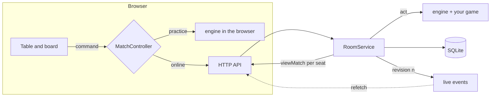

# Card Game Template

A production-shaped starting point for **turn-based, multiplayer card games** in TypeScript.
Write your rules once as a pure `GameDefinition`; the template already provides the rest:

- **Engine**: deals matches, applies commands, hides private cards per seat, drives bots,
  simulates thousands of games, and replays any match exactly from its seed.
- **Expansions (DLC)**: a registry of expansions with versioned rules, ownership and hooks into
  the base game; `pnpm new:expansion` scaffolds one. Ships with _Jokers & Tricks_.
- **Server**: authoritative rooms with live updates (Server-Sent Events), bot seats, SQLite
  persistence that survives restarts, and a hardened HTTP layer, organised as feature modules.
- **Platform**: accounts with passwords and recovery codes; profiles, XP, levels, missions,
  achievements and seasons; a coin shop, boosters and a collection of cosmetics; friends,
  presence, table invites, blocks and reports; a daily challenge; ranked duels with Elo.
- **Web client**: React 19, installable as a PWA, in **English and French** with typed
  translations: adding a language is one line plus the translations the compiler asks for.
- **Operations**: anonymous field telemetry, a server error log with alerts, Docker and Caddy.
- **Quality**: strict TypeScript, a conformance harness that fuzzes your rules, unit, HTTP and
  browser tests, enforced layer boundaries and CI.

It ships with **Crazy Eights** as a complete, tested example. Replace it with your game.

```text
packages/
  engine/     @cardgame/engine    Game-agnostic kernel: matches, views, bots, expansions. Pure.
  game/       @cardgame/game      YOUR RULES. Crazy Eights + its expansions: setup, commands, bots.
  meta/       @cardgame/meta      The metagame as pure data: items, levels, missions, boosters, Elo.
  i18n/       @cardgame/i18n      Typed translations, plurals and formatting. No dependency.
  protocol/   @cardgame/protocol  The wire contract between the server and its clients.
apps/
  server/     @cardgame/server    Node server: one folder per feature under src/features/.
  web/        @cardgame/web       React client: one folder per feature under src/features/.
docs/                             Architecture, engine API, guides.
scripts/                          Boundary check, bot simulator, project rename.
```

## Quick start

Requires Node 22.12+ and pnpm 10 (`corepack enable`).

```bash
pnpm install
pnpm dev          # app + real API on http://localhost:5173 (one process)
pnpm test         # unit, rules-conformance and HTTP tests
pnpm verify       # format, boundaries, types, tests, build: what CI runs
```

Production: `pnpm build && pnpm start` (port 3000), or `docker compose up -d --build`; see
[deployment](docs/deployment.md).

## Make it your game

1. `pnpm rename "Moon Poker" moon-poker` renames the project, the package scope and the image.
2. Write your rules in [`packages/game`](packages/game): state, commands, setup, `apply`,
   `legalCommands`, `view`, `outcome`, and a bot.
3. Draw your table in [`apps/web/src/game`](apps/web/src/game): the board, the log sentences,
   and the seat summary.
4. `pnpm test`: the conformance harness plays hundreds of seeded games against your rules and
   tells you which seed broke which contract.

The full walkthrough, with a checklist, is in **[docs/making-a-game.md](docs/making-a-game.md)**.

## How it fits together



The server is the only authority online: clients send commands with the revision they saw,
never state. Each seat gets its own projection (`view`), so other hands never leave the server.
More in [architecture](docs/architecture.md).

## Documentation

| Guide                                        | What it covers                                        |
| -------------------------------------------- | ----------------------------------------------------- |
| [Architecture](docs/architecture.md)         | Layers, data flow, authority, privacy, boundaries     |
| [Engine](docs/engine.md)                     | The `GameDefinition` contract and the engine API      |
| [Making a game](docs/making-a-game.md)       | Step-by-step derivation, with checklist               |
| [Expansions](docs/making-an-expansion.md)    | DLC: extra cards and rules, ownership, scaffolding    |
| [Adding a feature](docs/features.md)         | Server modules, events, web folders, registries       |
| [Translations](docs/i18n.md)                 | How text is translated, adding a language             |
| [Multiplayer](docs/multiplayer.md)           | Rooms, revisions, live events, bots, HTTP endpoints   |
| [Progression](docs/progression.md)           | XP, levels, missions, achievements, seasons, profiles |
| [Social](docs/social.md)                     | Friends, presence, invites, blocks, reports           |
| [Competitive](docs/competitive.md)           | Daily challenge, rankings, Elo and matchmaking        |
| [Testing](docs/testing.md)                   | Unit, conformance, HTTP, browser tests and simulation |
| [Design](docs/design.md)                     | Tokens, theming, components, accessibility            |
| [Economy](docs/economy.md)                   | Coins, items, boosters, the shop, tuning              |
| [Deployment](docs/deployment.md)             | Configuration, Docker, Caddy, backups                 |
| [Operations](docs/operations.md)             | Telemetry, error log, alerts, PWA updates and icons   |
| [Crazy Eights rules](packages/game/RULES.md) | The example game, as a rules-document template        |

## Scripts

| Command                | Does                                                        |
| ---------------------- | ----------------------------------------------------------- |
| `pnpm dev`             | Vite dev server with the real API mounted                   |
| `pnpm build`           | Production build of the web app (`apps/web/dist`)           |
| `pnpm start`           | Production server: API and built app on `PORT` (3000)       |
| `pnpm test`            | Vitest across every package                                 |
| `pnpm test:e2e`        | Playwright browser tests (builds, then serves on port 4317) |
| `pnpm check`           | TypeScript in every package                                 |
| `pnpm lint:boundaries` | Fails if a layer imports what it must not                   |
| `pnpm sim`             | Bot-vs-bot statistics: `pnpm sim --games 1000 --players 4`  |
| `pnpm verify`          | Everything CI checks, in order                              |
| `pnpm rename`          | Rename the template to your project                         |
| `pnpm icons`           | Draw the app icons (PWA, Apple) from the favicon            |
| `pnpm new:expansion`   | Scaffold an expansion (DLC) and register it                 |

## Origin

The architecture is extracted from **Deal Club**, a production multiplayer card game: pure
transitions, server authority, per-seat projection, revision-checked commands, SSE revision
signals with polling as a safety net, bot sweeps, and the HTTP hardening. The game-specific
parts (accounts, shop, progression, extensions) were left out; see
[architecture § extending](docs/architecture.md#extending) for where they would plug in.

Private and unlicensed: all rights reserved.
